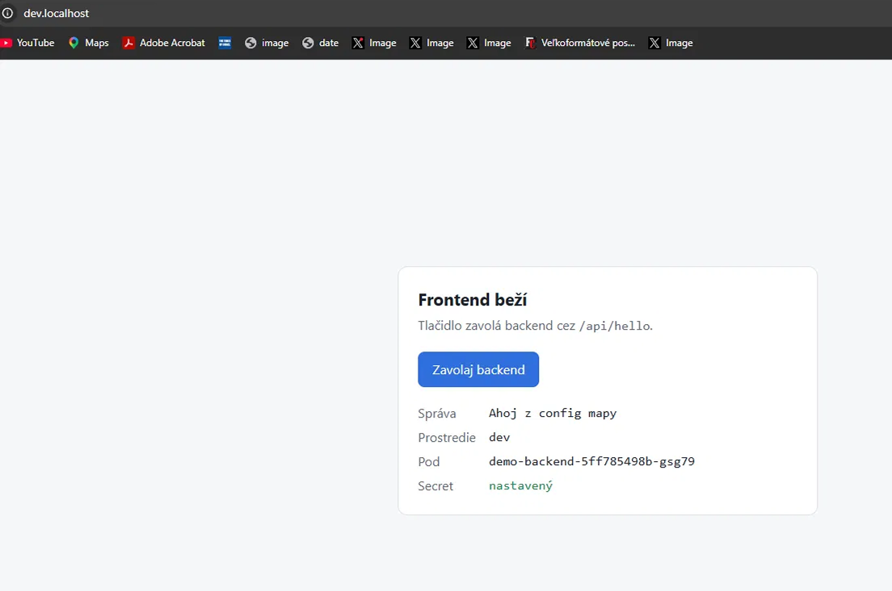
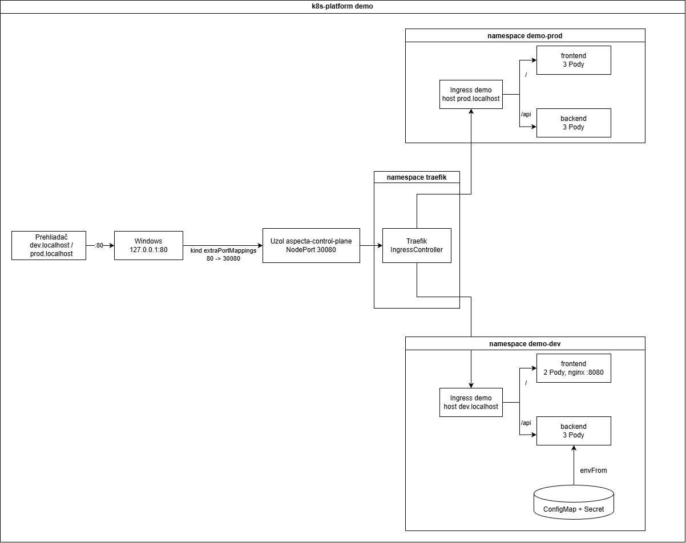

# k8s-platform-demo

Kubernetes prostredie pre jednoduchú webovú appku (frontend + backend). Klaster beží lokálne cez kind, appku nasadzujem vlastným Helm chartom do dvoch prostredí (dev a prod) a do klastra sa prichádza cez Traefik.

**Použité technológie:** kind (Kubernetes 1.35.8), Docker, Helm, Traefik, RBAC, NetworkPolicy, Python (Flask), nginx



Celý postup, príkazy a problémy, ktoré som riešil, sú v [docs/postup.md](docs/postup.md).

---

## Obsah

- [Dizajn](#dizajn)
- [Bezpečnosť](#bezpečnosť)
- [Štruktúra repa](#štruktúra-repa)
- [Inštalácia](#inštalácia)
- [Použitie](#použitie)
- [Prečo som to spravil takto](#prečo-som-to-spravil-takto)
- [Čo by som doplnil](#čo-by-som-doplnil)

---

## Dizajn



**Ako ide požiadavka:** prehliadač otvorí `dev.localhost` na porte 80. kind presmeruje tento port na port 30080 uzla, kde počúva Traefik. Traefik podľa Ingressu pošle `/api` na backend a všetko ostatné na frontend.

Frontend a backend spolu priamo nekomunikujú. Prehliadač si najprv stiahne stránku z frontendu a potom JavaScript v stránke zavolá `/api/hello` na tej istej adrese.

### Čo je v projekte

| Časť | Kde | Popis |
|---|---|---|
| kind klaster `aspecta` | `cluster/kind-config.yaml` | 1 control-plane a 2 workery, porty 80 a 443 len pre tento PC |
| Traefik | `cluster/traefik-values.yaml` | Ingress controller nainštalovaný cez Helm, vo vlastnom namespace `traefik` |
| frontend | `app/frontend` | statická stránka v nginx, port 8080 |
| backend | `app/backend` | Flask appka, port 8000, má endpointy `/api/hello`, `/healthz` a `/readyz` |
| Helm chart `demo-app` | `charts/demo-app` | všetky Kubernetes objekty appky |

### Dev a prod

Obe prostredia používajú ten istý chart. Líšia sa len hodnotami, `values-prod.yaml` obsahuje len to, čo je v produkcii inak.

| | dev | prod |
|---|---|---|
| namespace | `demo-dev` | `demo-prod` |
| adresa | `http://dev.localhost` | `http://prod.localhost` |
| počet Podov backend / frontend | 2 / 2 | 3 / 3 |
| `APP_ENV` | `dev` | `prod` |

### Škálovanie a dostupnosť

- každá appka má viac replík a Pody sa rozložia na oba workery
- Pody majú nastavené `requests` a `limits` pre CPU a pamäť
- **readiness probe** (`/readyz`): Pod dostane požiadavky, až keď je pripravený. Backend bez `API_KEY` pripravený nie je.
- **liveness probe** (`/healthz`): keď appka zamrzne, Kubernetes ju reštartuje
- keď zmením konfiguráciu a spravím `helm upgrade`, Pody sa vymenia samy (v šablóne je odtlačok ConfigMapy)

---

## Bezpečnosť

### RBAC

- **appky nemajú prístup ku Kubernetes API.** Backend aj frontend majú vlastný ServiceAccount bez práv a do kontajnera sa im nedáva token (`automountServiceAccountToken: false`).
- **používateľ smie len čítať.** Role `demo-viewer` dovoľuje pozerať Pody, logy, Services, ConfigMapy a Deploymenty, ale nie Secrety a nemôže nič meniť ani mazať. Komu sa dá, je v `values.yaml` v `rbac.viewers`.
- práva platia len v namespace appky

### NetworkPolicy

V namespace appky je najprv všetko zakázané a povolené je len to, čo appka naozaj potrebuje:

| Politika | Čo povoľuje |
|---|---|
| `demo-default-deny` | nič, zakáže všetku prevádzku do Podov aj z Podov |
| `demo-allow-dns` | DNS, aby Pody vedeli preložiť mená |
| `demo-backend-from-ingress` | na backend len z Traefiku, port 8000 |
| `demo-frontend-from-ingress` | na frontend len z Traefiku, port 8080 |

Endpointy `/healthz` a `/readyz` nie sú zvonka dostupné, Ingress púšťa na backend len `/api`.

### Kontajnery

- kontajnery nebežia ako root (backend ako používateľ 10001, frontend ako 101)
- v `securityContext` je zakázané spustenie ako root a získanie vyšších práv a sú odobraté všetky Linux capabilities
- všetky image majú presnú verziu, nie `latest`
- Secret nie je v Gite, vytvára sa príkazom pri inštalácii

---

## Štruktúra repa

```
k8s-platform-demo/
├── app/
│   ├── backend/            # Flask appka + Dockerfile
│   └── frontend/           # stránka + Dockerfile
├── cluster/
│   ├── kind-config.yaml    # nastavenie klastra
│   └── traefik-values.yaml # moje hodnoty pre Traefik
├── charts/
│   └── demo-app/           # Helm chart appky
│       ├── Chart.yaml
│       ├── values.yaml         # dev
│       ├── values-prod.yaml    # rozdiely pre prod
│       └── templates/          # šablóny
└── docs/
    ├── postup.md           # postup práce
    └── images/
```

---

## Inštalácia

### Čo treba mať

- Docker Desktop
- [kind](https://kind.sigs.k8s.io/) 0.24 alebo novší (staršie verzie NetworkPolicy neblokujú)
- kubectl (najlepšie 1.34 až 1.36)
- Helm
- voľné porty 80 a 443

Na Windowse sa kind a Helm dajú nainštalovať cez `winget install Kubernetes.kind` a `winget install Helm.Helm`. Príkazy nižšie sú pre PowerShell.

### 1. Repo a image

```powershell
git clone https://github.com/samuel10998/k8s-platform-demo.git
cd k8s-platform-demo

docker build -t backend:0.1.0 app/backend
docker build -t frontend:0.1.0 app/frontend
```

### 2. Klaster

```powershell
kind create cluster --config cluster/kind-config.yaml
kubectl wait --for=condition=Ready nodes --all --timeout=180s
kind load docker-image backend:0.1.0 frontend:0.1.0 --name aspecta
```

Uzly kind nevidia image z Dockeru, preto ich treba nahrať cez `kind load`.

### 3. Traefik

```powershell
helm repo add traefik https://traefik.github.io/charts
helm repo update
helm install traefik traefik/traefik --version 42.3.0 -f cluster/traefik-values.yaml -n traefik --create-namespace
kubectl wait --for=condition=Ready pods --all -n traefik --timeout=120s
```

### 4. Appka – dev

```powershell
kubectl create namespace demo-dev
kubectl create secret generic backend-secret --from-literal=API_KEY=<hodnota> -n demo-dev
helm install demo charts/demo-app -n demo-dev
kubectl wait --for=condition=Ready pods --all -n demo-dev --timeout=120s
```

### 5. Appka – prod

```powershell
kubectl create namespace demo-prod
kubectl create secret generic backend-secret --from-literal=API_KEY=<hodnota> -n demo-prod
helm install demo charts/demo-app -n demo-prod -f charts/demo-app/values-prod.yaml
kubectl wait --for=condition=Ready pods --all -n demo-prod --timeout=120s
```

Namespace a Secret vytváram pred inštaláciou chartu, lebo Secret nemá byť v Gite a ten istý chart ide do dvoch namespace.

### Zmazanie

```powershell
kind delete cluster --name aspecta
```

---

## Použitie

### Appka

- dev: <http://dev.localhost>
- prod: <http://prod.localhost>

Tlačidlo „Zavolaj backend“ ukáže správu z ConfigMapy, prostredie, ktorý Pod odpovedal a či je nastavený Secret. Adresy končiace na `.localhost` fungujú bez úpravy súboru `hosts`.

```powershell
curl.exe http://dev.localhost/api/hello
curl.exe http://prod.localhost/api/hello
```

### Čo beží

```powershell
helm list -A
kubectl get pods,svc,ingress,networkpolicy -n demo-dev
```

### Zmena a návrat späť

```powershell
# po zmene v charte alebo vo values
helm upgrade demo charts/demo-app -n demo-dev
helm upgrade demo charts/demo-app -n demo-prod -f charts/demo-app/values-prod.yaml

# história a návrat na staršiu verziu
helm history demo -n demo-dev
helm rollback demo <revízia> -n demo-dev
```

### Overenie bezpečnosti

```powershell
# RBAC
kubectl auth can-i list pods -n demo-prod --as samuel      # yes
kubectl auth can-i get secrets -n demo-prod --as samuel    # no
kubectl auth can-i delete pods -n demo-prod --as samuel    # no

# v kontajneri nie je token a nebeží ako root
kubectl exec -n demo-dev deploy/demo-backend -- ls /var/run/secrets/kubernetes.io/serviceaccount   # No such file
kubectl exec -n demo-dev deploy/demo-backend -- id                                                  # uid=10001

# NetworkPolicy: z iného namespace aj z toho istého → timeout
kubectl run test --rm -it --restart=Never --image=busybox:1.37 -n default -- wget -qO- -T 3 http://demo-backend.demo-dev
kubectl run test --rm -it --restart=Never --image=busybox:1.37 -n demo-dev -- wget -qO- -T 3 http://demo-backend
```

---

## Prečo som to spravil takto

| Rozhodnutie | Prečo |
|---|---|
| kind namiesto Kubernetes v Docker Desktope | v Docker Desktope NetworkPolicy nič neblokuje, v kind áno |
| presná verzia Kubernetes v kind configu | každý dostane rovnaký klaster |
| Traefik namiesto ingress-nginx | ingress-nginx sa od marca 2026 už nevyvíja |
| Traefik vo vlastnom namespace | patrí celému klastru, nie jednej appke |
| NodePort namiesto LoadBalancer | kind nemá load balancer, v cloude by som použil LoadBalancer |
| Helm | jedny šablóny pre dev aj prod, upgrade a rollback celej appky naraz |
| namespace a Secret mimo chartu | chart ide do rôznych namespace a Secret nemá byť v Gite |
| `values-prod.yaml` len s rozdielmi | zmena vo `values.yaml` sa prejaví v oboch prostrediach |
| `USER 10001` v Dockerfile ako číslo | Kubernetes vie overiť, že kontajner nebeží ako root, len pri čísle |

---

## Čo by som doplnil

- **monitoring:** Prometheus a Alertmanager a základné alerty, napríklad keď sa Pod stále reštartuje
- **HTTPS:** certifikáty cez cert-manager
- **lepšie riešenie Secretov:** napríklad Sealed Secrets, aby aj Secret mohol byť v Gite
- **automatické škálovanie** podľa záťaže (HPA) a viac replík Traefiku
- **cloud:** spravovaný klaster (AKS alebo EKS) a skutočná doména

---

Pri práci som používal AI ako pomoc (vysvetlenia, kontrola chýb). Dockerfiles, YAML a chart som písal sám a všetko som spúšťal a overoval u seba.
