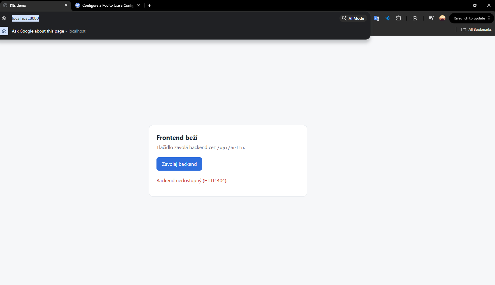

# Postup

Moje poznámky k projektu: čo som robil, aké príkazy som použil a čo mi nefungovalo. Návod na inštaláciu je v README.

Robím na Windows 11 v PowerShelli, s Docker Desktopom, kind, kubectl 1.34.1 (je z Docker Desktopu) a Helmom.

Pri práci som používal AI ako pomoc (vysvetlenia, kontrola chýb, keď som sa zasekol). Dockerfiles a YAML som písal sám a všetko som spúšťal u seba.

---

## Fáza 0 – prostredie

### Nástroje

kind a Helm som nainštaloval cez winget. Potom treba PowerShell zavrieť a otvoriť znova, inak príkazy nenájde.

```powershell
winget install Kubernetes.kind
winget install Helm.Helm
kind version
helm version
kubectl version --client
```

kind: doplniť, Helm: doplniť, kubectl: 1.34.1

### Repo

Na GitHube som vytvoril verejný repozitár `k8s_platform_demo` s README a MIT licenciou a naklonoval som ho do Documents. Appku (backend a frontend) som rozbalil do priečinka `app`.

Do `.gitignore` som dal `logs/`, lebo tam ukladám nahrávky terminálu a je v nich meno PC a môžu tam byť aj heslá.

```powershell
git status          # logs/ tam nie je, takže .gitignore funguje
git add .
git commit -m "feat: add demo app"
git push
```

### Nahrávanie terminálu

Aby som mal záznam toho, čo som robil, nahrávam PowerShell cez `Start-Transcript`. Nahráva sa len to jedno okno. Keď ho zavriem alebo otvorím nové, treba to spustiť znova s `-Append`.

```powershell
Start-Transcript -Path .\logs\faza0.txt
Start-Transcript -Path .\logs\faza0.txt -Append    # po pauze
Stop-Transcript
```

### Dockerfiles

Backend (`app/backend/Dockerfile`):

```dockerfile
FROM python:3.12.16-slim
WORKDIR /app
COPY requirements.txt .
RUN pip install --no-cache-dir -r requirements.txt
RUN useradd --uid 10001 --create-home appuser
COPY app.py .
USER 10001
EXPOSE 8000
CMD ["gunicorn", "--bind", "0.0.0.0:8000", "app:app"]
```

- najprv kopírujem `requirements.txt` a inštalujem knižnice, až potom `app.py`, aby sa pri zmene kódu knižnice nemuseli inštalovať znova (cache)
- používateľ má pevné UID 10001, lebo Kubernetes pri `runAsNonRoot` vie skontrolovať len číslo, nie meno
- gunicorn namiesto servera z Flasku, ten je len na vývoj

Frontend (`app/frontend/Dockerfile`):

```dockerfile
FROM nginx/nginx-unprivileged:1.30.6-alpine
COPY index.html /usr/share/nginx/html/index.html
EXPOSE 8080
```

- nginx-unprivileged beží bez roota (UID 101), preto port 8080 (pod 1024 môže len root)
- `index.html` prepíše predvolenú stránku „Welcome to nginx“

Build:

```powershell
docker build -t backend:0.1.0 app\backend
docker build -t frontend:0.1.0 app\frontend
```

Verzie som dal presné, aby sa image o mesiac postavil rovnako, a tag `0.1.0` namiesto `latest`, lebo pri `latest` by Kubernetes image vždy hľadal na Docker Hube.

### Test cez docker run

```powershell
# backend bez API_KEY
docker run -d --name backend-test -p 8000:8000 backend:0.1.0
curl.exe -i http://localhost:8000/api/hello
curl.exe -i http://localhost:8000/healthz
curl.exe -i http://localhost:8000/readyz
docker exec backend-test id

# backend s API_KEY
docker rm -f backend-test
docker run -d --name backend-test -p 8000:8000 -e API_KEY=test123 -e APP_ENV=lokal backend:0.1.0
curl.exe -i http://localhost:8000/readyz
curl.exe http://localhost:8000/api/hello

# frontend
docker run -d --name frontend-test -p 8080:8080 frontend:0.1.0
docker exec frontend-test id

docker rm -f backend-test frontend-test
```

V PowerShelli treba písať `curl.exe`, lebo samotné `curl` je tam niečo iné.

Čo vyšlo:

- backend bez `API_KEY`: `/api/hello` a `/healthz` vrátili 200, `/readyz` vrátil 503
- backend s `API_KEY`: `/readyz` vrátil 200, v `/api/hello` je `environment: lokal` a `secret_configured: true`
- backend beží ako `uid=10001(appuser)`
- frontend: stránka sa ukáže, tlačidlo píše HTTP 404, lebo nginx nemá `/api` (to vyrieši Ingress)
- frontend beží ako `uid=101(nginx)`

```powershell
git add .
git commit -m "feat: dockerfiles"
git push
```

### kind klaster

Kubernetes v Docker Desktope NetworkPolicy neblokuje, preto som použil kind. Klaster mám v súbore `cluster/kind-config.yaml`: 1 control-plane, 2 workery, Kubernetes 1.35.8 a porty 80 a 443 len na `127.0.0.1`, aby klaster nebol dostupný z domácej siete.

```yaml
kind: Cluster
apiVersion: kind.x-k8s.io/v1alpha4
name: aspecta

nodes:
  - role: control-plane
    image: kindest/node:v1.35.8@sha256:07b2536e30b803ed61d1677a79df6115f798ce64c80f9e22f6ed45afd09323c0
    extraPortMappings:
      - containerPort: 30080
        hostPort: 80
        listenAddress: "127.0.0.1"
        protocol: TCP
      - containerPort: 30443
        hostPort: 443
        listenAddress: "127.0.0.1"
        protocol: TCP

  - role: worker
    image: kindest/node:v1.35.8@sha256:07b2536e30b803ed61d1677a79df6115f798ce64c80f9e22f6ed45afd09323c0

  - role: worker
    image: kindest/node:v1.35.8@sha256:07b2536e30b803ed61d1677a79df6115f798ce64c80f9e22f6ed45afd09323c0
```

Porty 30080 a 30443 sú preto, lebo tam neskôr bude NodePort Traefiku (NodePorty sú v rozsahu 30000–32767).

```powershell
kind create cluster --config cluster\kind-config.yaml
kubectl config current-context        # kind-aspecta
kubectl version
kubectl wait --for=condition=Ready nodes --all --timeout=120s
kubectl get nodes
docker ps
```

Prvý klaster som vytvoril bez `image` a dostal som Kubernetes 1.37. kubectl hlásil, že je to oproti mojej verzii 1.34 moc veľký rozdiel. Klaster som zmazal a ku každému uzlu som pridal image s verziou 1.35.8. Musí byť pri všetkých troch, inak by workery mali inú verziu ako control-plane.

### Image do klastra

Uzly kind nevidia image z Docker Desktopu, treba ich tam nahrať:

```powershell
kind load docker-image backend:0.1.0 frontend:0.1.0 --name aspecta
docker exec aspecta-worker crictl images | findstr "backend frontend"
```

### Test NetworkPolicy

Chcel som si overiť, že kind NetworkPolicy naozaj blokuje.

```powershell
kubectl create namespace np-test
kubectl run web --image=nginx:1.30.6-alpine --labels=app=web --port=80 -n np-test
kubectl expose pod web --port=80 -n np-test
kubectl wait --for=condition=Ready pod/web -n np-test --timeout=60s

# bez politiky
kubectl run test --rm -it --restart=Never --image=busybox:1.37 -n np-test -- wget -qO- -T 3 http://web

kubectl apply -f C:\Users\samue\Desktop\np-test.yaml

# s politikou
kubectl run test --rm -it --restart=Never --image=busybox:1.37 -n np-test -- wget -qO- -T 3 http://web

kubectl delete namespace np-test
```

`np-test.yaml`:

```yaml
apiVersion: networking.k8s.io/v1
kind: NetworkPolicy
metadata:
  name: zakaz-vsetko
  namespace: np-test
spec:
  podSelector: {}
  policyTypes:
    - Ingress
```

Bez politiky busybox stiahol stránku nginx, s politikou skončil `download timed out`, takže to funguje. DNS išlo aj tak, lebo politika blokuje len prichádzajúcu prevádzku do Podov.

```powershell
git add .
git commit -m "feat: kind config"
git push
```

### S čím som si potreboval pomôcť
- čo sú kind a Helm a ako ich nainštalovať
- ako sa klaster opíše v `kind-config.yaml` (uzly, `extraPortMappings`) a prečo porty 30080 a 30443
- prečo sa klaster vytvára cez `kind create cluster` a nie cez `kubectl apply`
- `kind load docker-image` a ako sa pozrieť do uzla cez `crictl images`
- ako zafixovať verziu Kubernetes v kind cez `image` s digestom
- pevné UID v Dockerfile (`USER 10001` namiesto `USER appuser`): Kubernetes pri `runAsNonRoot` vie overiť len číslo, pri mene by Pod nenaštartoval 
- aký tag `nginx-unprivileged` vybrať a prečo `alpine` a nie Debian (tag bez prípony je Debian, 58 MB oproti 21 MB)
- `Start-Transcript` na nahrávanie terminálu. Prvýkrát som to používal na zapisovanie logov naživo.
- Klaster cez YAML súbor (`kind-config.yaml`) som robil prvýkrát. Musel som si pomôcť so štruktúrou súboru a s tým, ako sa z neho klaster vytvorí.
- NetworkPolicy som tiež robil prvýkrát. Musel som si pomôcť s tým, ako funguje a ako otestovať, že naozaj blokuje.

### Problémy

- Pri `docker build` som omylom dal dve cesty naraz a hlásil, že chce 1 argument.
- Najnovšie verzie nginx-unprivileged neboli pod `nginxinc`, sú pod `nginx/nginx-unprivileged`.
- Tag `1.30.6` bez prípony je Debian (58 MB), správny je `1.30.6-alpine` (21 MB).
- `/readyz` hneď po štarte vrátil `Empty reply from server`, gunicorn ešte nebežal. O sekundu neskôr to bolo OK.
- Po prvom vytvorení klastra hlásil `kubectl version`, že môj kubectl 1.34 a klaster 1.37 sú od seba moc ďaleko (podporovaný rozdiel je 1 verzia). S pomocou AI som do configu pridal image s verziou 1.35.8. Zistil som, že musí byť pri všetkých troch uzloch, inak by workery dostali predvolenú 1.37 a mali by inú verziu ako control-plane.
- `Stop-Transcript` hlásil, že nič nenahráva. Omylom som zavrel PowerShell a v novom okne som nahrávanie znova nespustil.

---

## Fáza 1 – appka v klastri

### Súbory v k8s/

- `00-namespace.yaml` – namespace `demo-dev`
- `10-backend-config.yaml` – ConfigMap `backend-config` s `APP_GREETING` a `APP_ENV: dev`
- `20-backend.yaml` – Deployment `backend` a Service `backend-service`
- `30-frontend.yaml` – Deployment `frontend` a Service `frontend-service`

Čísla pred menami sú preto, lebo `kubectl apply -f k8s\` berie súbory abecedne a namespace musí byť prvý. Sú po desiatkach, aby sa dal neskôr vložiť súbor medzi ne.

Backend:

- 2 repliky, image `backend:0.1.0`, port 8000
- premenné z ConfigMapy aj zo Secretu cez `envFrom`
- requests `cpu: 50m`, `memory: 64Mi`, limits `cpu: 200m`, `memory: 128Mi`
- readiness probe na `/readyz` (bez `API_KEY` Pod nebude Ready), liveness probe na `/healthz`
- Service ClusterIP, port 80 → 8000

Frontend:

- 2 repliky, image `frontend:0.1.0`, port 8080
- requests `cpu: 25m`, `memory: 32Mi`, limits `cpu: 100m`, `memory: 64Mi`
- readiness aj liveness probe na `/`
- Service ClusterIP, port 80 → 8080

Obe Services majú port 80, aby sa na ne Ingress vo fáze 2 pripájal rovnako.

### Secret

Secret nie je v Gite, vytváram ho príkazom. Najprv musí existovať namespace:

```powershell
kubectl apply -f k8s\00-namespace.yaml
kubectl create secret generic backend-secret --from-literal=API_KEY=<hodnota> -n demo-dev
```

### Nasadenie

```powershell
kubectl apply --dry-run=client -f k8s\        # kontrola súborov, nič sa nevytvorí
kubectl apply -f k8s\
kubectl wait --for=condition=Ready pods --all -n demo-dev --timeout=120s
kubectl get pods -n demo-dev -o wide
kubectl get endpointslices -n demo-dev
```

`kubectl get endpoints` funguje tiež, ale od Kubernetes 1.33 hlási, že je zastaraný, preto `endpointslices`.

### Overenie

```powershell
# backend cez Service, viackrát
kubectl run test --rm -it --restart=Never --image=busybox:1.37 -n demo-dev -- wget -qO- -T 3 http://backend-service/api/hello

# frontend cez Service
kubectl run test --rm -it --restart=Never --image=busybox:1.37 -n demo-dev -- wget -qO- -T 3 http://frontend-service

# prehliadač
kubectl port-forward svc/frontend-service 8080:80 -n demo-dev
```

Čo vyšlo:

- 4 Pody `1/1 Running`, z každej appky jeden na `aspecta-worker` a jeden na `aspecta-worker2`
- každá Service má 2 endpointy, v nich sú IP Podov a porty 8000 a 8080 (nie 80, endpointy ukazujú priamo na Pody)
- `/api/hello` vrátil `environment: dev`, správu z ConfigMapy a `secret_configured: true`, odpovedali oba Pody
- `http://frontend-service` vrátil HTML stránky
- `http://frontend-service/api/hello` vrátil 404, lebo nginx nemá `/api`
- cez port-forward sa stránka ukázala na `localhost:8080`, tlačidlo píše HTTP 404 (vyrieši Ingress)



### Git

Od tejto fázy robím každú fázu vo vlastnej vetve a do `main` ju dávam cez pull request.

```powershell
git switch -c faza-1
git add k8s docs
git commit -m "feat: k8s manifesty pre appku"
git push -u origin faza-1
# PR na GitHube, merge
git switch main
git pull
```

### S čím som si potreboval pomôcť

- prečo čísla pred menami súborov (zistil som, že `kubectl apply -f k8s\` berie súbory abecedne, takže s číslami ich aplikuje v poradí, v akom ich potrebujem, napr. namespace ako prvý, lebo ostatné objekty doň patria)
- `--dry-run=client` na celý priečinok (zistil som, že spracuje súbory ako apply, ale nič nevytvorí. Keď je v súbore chyba, dozviem sa to skôr, ako by som chybný súbor aplikoval do klastra. Zachytí ale len chyby v zápise, nie napr. zlé meno Service alebo zlý port)
- `endpointslices` namiesto `endpoints` (zistil som, že starý objekt Endpoints je od Kubernetes 1.33 zastaraný a nahradili ho EndpointSlices, ktoré sa pri veľkom počte Podov dajú rozdeliť na viac častí)
- ako napísať readiness a liveness probe a aký je medzi nimi rozdiel

### Problémy

- V Deploymente backendu som mal 2 chyby: `ports` som nemal ako zoznam a v probes som mal `port` vedľa `httpGet` namiesto pod ním (`path` a `port` patria pod `httpGet`).

